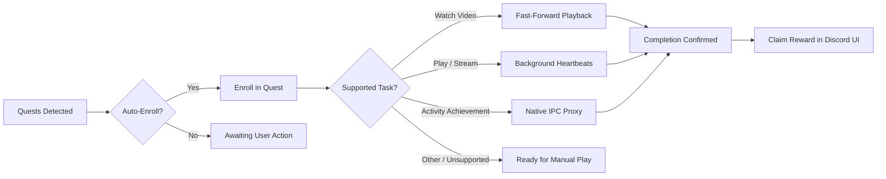

<h1 align="center">QuestCompleter</h1>

<p align="center">
  
</p>

<p align="center">
  <a href="https://github.com/itskonv1/QuestCompleter/blob/main/LICENSE">
    
  </a>
  
  
  
</p>

<p align="center">
  <b>A background automation plugin for Equicord and Vencord that automatically accepts new quests and completes supported tasks without needing to run games or wait out video timers.</b>
</p>

---

## Architecture Flow



---

## Features

| Feature | Description | State |
| :--- | :--- | :---: |
| **Auto-Enroll** | Automatically accepts and enrolls in all available quests as soon as they drop | Active |
| **Background Runner** | Simulates gameplay and streaming heartbeats without launching any game executable | Active |
| **Instant Video Progression** | Skips playback wait times using elapsed enrollment duration | Active |
| **IPC Bridge** | Solves Discord activity achievement quests by safely bypassing renderer CSP limitations | Active |
| **Mobile Video Mode** | Dynamically adapts mobile-only video quests to be watchable and completable on desktop | Active |
| **Toast Notifications** | Delivers clear alerts when quests are enrolled or finished | Active |
| **Native Claiming** | Leaves reward redemption to Discord's official interface to prevent claim conflicts | Active |

---

## Supported Quest Types

| Quest Task Type | Execution Strategy | Auto-Enroll | Auto-Complete |
| :--- | :--- | :---: | :---: |
| `WATCH_VIDEO` | Accelerated playback timestamps | Yes | Yes |
| `WATCH_VIDEO_ON_MOBILE` | Desktop task injection | Yes | Yes |
| `PLAY_ON_DESKTOP` | Periodic heartbeat dispatches | Yes | Yes |
| `PLAY_ON_DESKTOP_V2` | Periodic heartbeat dispatches | Yes | Yes |
| `PLAY_ON_XBOX` | Console heartbeat emulation | Yes | Yes |
| `PLAY_ON_PLAYSTATION` | Console heartbeat emulation | Yes | Yes |
| `PLAY_ACTIVITY` | Activity session heartbeats | Yes | Yes |
| `STREAM_ON_DESKTOP` | Stream key channel simulation | Yes | Yes |
| `ACHIEVEMENT_IN_ACTIVITY` | OAuth proxy ticket bridge | Yes | Yes |
| `ACHIEVEMENT_IN_GAME` | Game-side trigger requirements | Yes | Manual |

---

## Prerequisites

QuestCompleter runs as a user plugin inside an **Equicord** or **Vencord** source build.

| Tool | Recommended Version | Purpose |
| :--- | :--- | :--- |
| **Git** | Latest | Cloning mod and plugin repositories |
| **Node.js** | v20.x or v22.x LTS | JavaScript runtime and compiler environment |
| **pnpm** | v9+ or v12+ | Dependency management and build scripts |
| **Equicord / Vencord** | Latest `main` / `dev` branch | Target client mod compiled from source |

---

## Installation

### 1. Clone into `src/userplugins`

Navigate to your local Equicord or Vencord source directory and clone the repository:

```bash
git clone https://github.com/itskonv1/QuestCompleter.git src/userplugins/QuestCompleter
```

### 2. Build and Inject

Run your project build and injection commands from the root of your Equicord or Vencord directory:

```bash
pnpm install
pnpm build
pnpm inject
```

### 3. Enable the Plugin

1. Completely close Discord (from your system tray or task manager) and launch it again.
2. Open **User Settings** (`Ctrl + ,`).
3. Under the **Plugins** section, search for **QuestCompleter** and toggle it on.

---

## Configuration

You can customize plugin behavior under **User Settings** -> **Plugins** -> **QuestCompleter**:

| Setting | Type | Default | Description |
| :--- | :---: | :---: | :--- |
| `autoStart` | `BOOLEAN` | `true` | Automatically accepts and enrolls all unenrolled quests upon detection |
| `showNotifications` | `BOOLEAN` | `true` | Shows toast notifications when quests are enrolled or finished |
| `completeVideoQuestsQuicker` | `BOOLEAN` | `true` | Uses elapsed time since enrollment to fast-forward video quest requirements |
| `makeMobileVideoQuestsDesktopCompatible` | `BOOLEAN` | `true` | Adapts mobile-exclusive video quests so they can be processed on desktop |
| `debugMode` | `BOOLEAN` | `false` | Prints verbose logging and network responses to the DevTools console |

---

<p align="center">
  Developed by <b>@kon</b>
</p>
